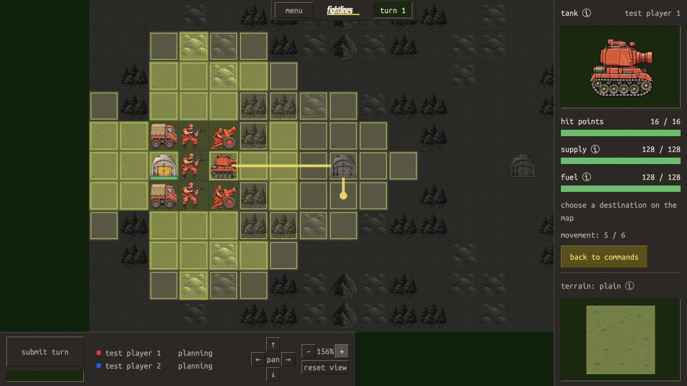
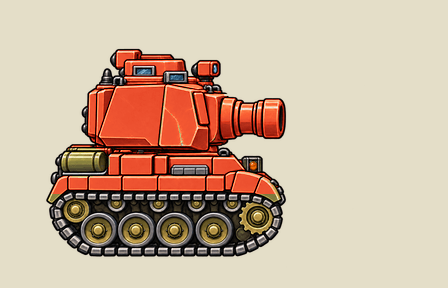
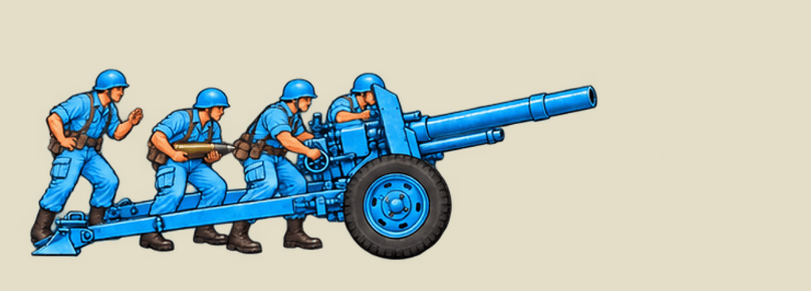
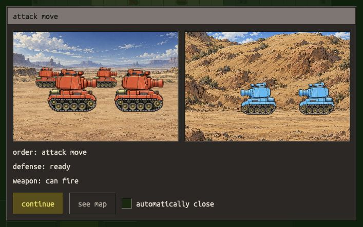
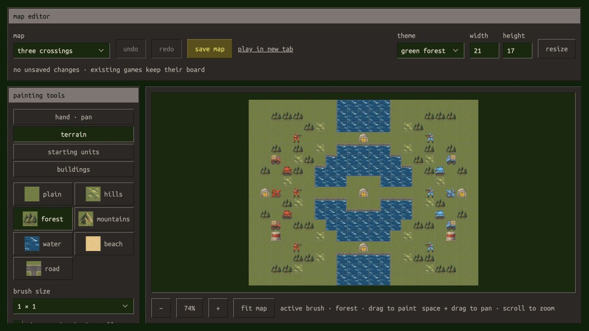

<div align="center">
  
  <p>a turn based strategy game based on logistics, supply, and transportation</p>
  <p>
    <a href="#the-game">The game</a> ·
    <a href="#combat-in-motion">Combat</a> ·
    <a href="#engineering-highlights">Engineering</a> ·
    <a href="#run-locally">Run locally</a> ·
    <a href="#documentation">Documentation</a>
  </p>
</div>



## The game

Both commanders plan their orders, then watch the battlefield resolve on a shared
movement timeline. A faster tank can intercept a convoy. Infantry can disappear
into a forest. An army that wins the firefight can still run out of supplies.

FightLines makes logistics part of the fight: trucks share cargo space between
troops, provisions, and fuel, while finite depots turn every delivery route into
a tactical decision. Play against another person through an invite lobby, or
choose an AI opponent.

- **Combined arms:** infantry, tanks, field guns, and transports; directional
  ambushes, attack moves, indirect fire, entrenchment, and sabotage.
- **Contested information:** shared sight, elevation, forest concealment, and
  firing reveals affect what each commander can see and target.
- **A battlefield in motion:** illustrated sprites, animated water, combat
  theaters, synchronized weapon audio, and a camera that follows visible action.
- **A complete authoring loop:** edit terrain and starting forces, save a map,
  and test it in a new game. Forest, desert, and snow themes share the same rules.
- **Tools for understanding a turn:** browse recorded games, switch player views,
  inspect orders, and replay combat with the recorded fog of war.

## Combat in motion

Tanks recoil through muzzle flash and drifting smoke. Field-gun crews signal,
brace, fire, and recover. These looping previews use the game's firing artwork.

<table>
  <tr>
    <td width="34%"></td>
    <td width="66%"></td>
  </tr>
  <tr>
    <td align="center"><sub>Tank firing sequence</sub></td>
    <td align="center"><sub>Field-gun firing sequence</sub></td>
  </tr>
</table>

In-game encounters bring the formations together over terrain-specific backdrops.
Live games and recorded replays share the same combat presentation.



## Engineering highlights

### One authoritative simulation

Rust validates orders and resolves movement, combat, transport, replenishment,
and upkeep. Movement arrivals share a timeline based on terrain cost and unit
speed, so interception and simultaneous contact emerge from the same rules.
Elm receives rule values for immediate local previews; the server validates the
submitted plan again.

[Turn engine](src/turns.rs) · [Movement resolution](src/movement_resolution.rs)

### Hidden information enforced at the boundary

The server projects the board and every playback frame for the requesting
player. Hidden enemies, routes, and private resource values are withheld from
responses. Playback and camera framing use those filtered observations.

[Visibility and projection](src/visibility.rs) · [Playback](src/Game/TurnPlayback.elm)

### Tactical AI that uses the game engine

The AI evaluates candidate plans through the ordinary turn
validator and resolver. It compares stationary and advancing enemy
responses and favors safer worst-case outcomes. Planning uses observed enemies
and assumed resources, while truck coordination weighs transport, supply, and
fuel needs.

[Tactical search](src/ai/search.rs) · [Logistics](src/ai/logistics.rs)

### Recorded games as a debugging tool

Versioned archives retain starting boards, accepted orders, and resolved frames.
Records are published atomically before in-memory state changes. An offline
replay command compares recorded outcomes with the current engine; the browser
viewer plays captured results so historical games remain inspectable after rule
changes.

[Archive storage and verification](src/game_log.rs) · [Replay viewer](src/DevTools/Page/GameReplay.elm)

### Typed boundaries and shared presentation

Juniper's Rust GraphQL contract generates the Elm API client. Elm custom types
model planning and turn phases, while separate player and DevTools applications
share battlefield rendering and playback. Keyboard controls and reduced-motion
behavior are part of the interface.

[Architecture](ARCHITECTURE.md) · [Generated API workflow](docs/DEVELOPMENT.md#generated-api) · [Design system](DESIGN_SYSTEM.md)

## Build the battlefield

The local map editor supports terrain painting, connected roads, starting forces,
buildings, mirroring, resizing, and undo/redo. Validated JSON maps are discovered
at runtime, so new scenarios require no application rebuild.



[Map authoring guide](docs/MAPS.md) · [Map definitions](maps/)

## Run locally

Requires Rust/Cargo with edition 2024 support, Elm 0.19.3, Node.js 22+, npm,
and Make. Install `elm-format` for development checks.

```sh
git clone https://github.com/Chadtech/fightlines2.git
cd fightlines2
npm ci
cp .env.example .env
make run
```

Open [localhost:8080](http://127.0.0.1:8080), choose **play**, and create a lobby.
Select an AI opponent for a solo game, or share the invite link with a second
player. Use separate browser profiles when testing both sides on one machine.

| Command | Purpose |
| --- | --- |
| `make run` | Build and start the game locally |
| `make dev` | Enable a preview game, map editor, replay browser, and backdrop tools |
| `make check` | Check formatting, Clippy, fast tests, frontend behavior, and compilation |
| `make check-all` | Run all checks, including slow AI simulations |
| `make build` | Build the server and production player frontend |

**Current status:** playable prototype under active development. Active games and
lobbies live in memory and reset when the server restarts; recorded archives
remain on disk. See [deployment](DEPLOYMENT.md) for hosting and tool-access details.

## Documentation

The detailed rules and development workflows live in linked guides, keeping this
page focused on the project while preserving the reference material.

| Guide | What's inside |
| --- | --- |
| [Playing](docs/PLAYING.md) | Controls, orders, combat, fog, transport, and resources |
| [Development](docs/DEVELOPMENT.md) | Setup, app layout, fixtures, builds, audio, replay, and debugging tools |
| [Maps](docs/MAPS.md) | Runtime catalog, map editor, and scenario notes |
| [Architecture](ARCHITECTURE.md) | State ownership, data flow, API boundaries, and simulation design |
| [Code style](CODE_STYLE.md) · [Review checklist](CODE_REVIEW.md) | Implementation conventions and verification |
| [Design system](DESIGN_SYSTEM.md) | Visual language, interaction, and accessibility |
| [Deployment](DEPLOYMENT.md) | Configuration, production builds, and archive storage |
| [Contributor instructions](AGENTS.md) | Repository workflow for coding agents |

Artwork and sprite provenance are documented in [runtime assets](public/assets/README.md);
audio sources and extraction details are in [audio assets](public/audio/README.md).
