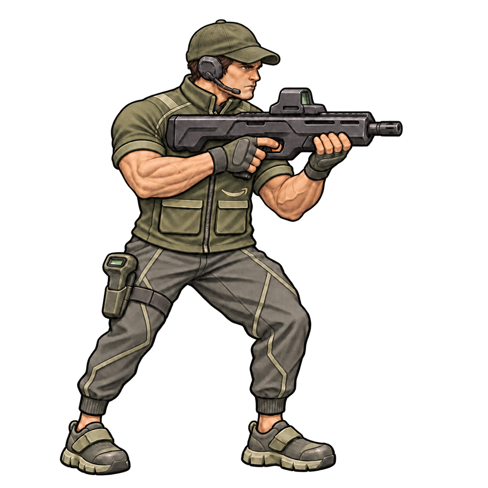

# Amazon Corporate

Approved source: [concept-v5.png](concept-v5.png).

## Preserve

Keep technical sports/workwear, jogger trousers, safety sneakers, thigh-mounted scanner, and subdued smile badge. Keep the olive cloth baseball cap with a plain curved bill and the separate headset and boom mic.

Shared constraints: muted olive palette, dark equipment, muscular build with upper-arm cloth sleeves and exposed muscular forearms; full figure, right-facing three-quarter rifle-ready pose and painterly game illustration. Distinguish attire, boots, trousers, headgear and weapon rather than adding pouches.

## Next edit

No new visual change specified yet. Start from this current PNG, name the precise requested change and explicitly preserve all other approved traits. Save the next revision alongside it and append the prompt and feedback here.

## History

- v2: stronger faction-specific clothing silhouettes. US v2 accepted.
- v3: muscular build and faction refinements; exposed upper arms later rejected.
- v4: restored sleeves while retaining exposed forearms.
- v5: replaced the segmented armored cap and bill-mounted scanner with a cloth baseball cap. Approved on 2026-11-11.

See [recorded prompts](PROMPTS.md). Do not rerun old prompts as the latest design brief.
