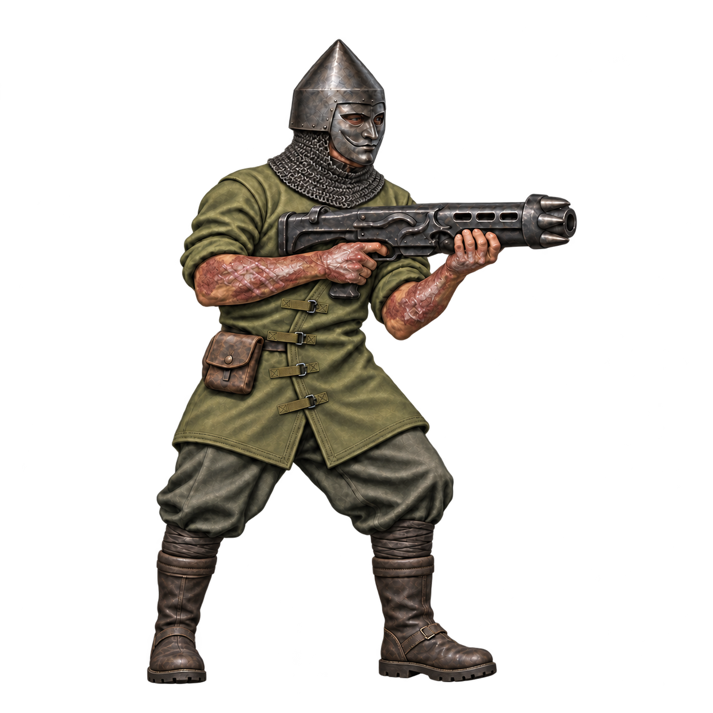

# Chaos Cultist

Current source: [concept-v11.png](concept-v11.png).

## Preserve

Keep the pointed Cuman-inspired steel helmet with a flush engraved mustache and no plume. The chainmail tapers from the neck to the upper chest, exposing both outer shoulders. Preserve healed burn scarring across the bare forearms and hands, including the visible raised ritual scars.

Keep the olive cross-front coat with flat webbing tabs and plain reinforced seams, dark trousers and calf wraps, and tall lug-soled field boots. The fictional dark steel gun has a crown of short forward-facing muzzle teeth. Keep the drumless, low-profile silhouette.

Preserve the shared muted olive palette, warm skin tones, full-body right-facing three-quarter pose, transparent padding, and realistic painted sprite rendering.

## Next edit

No new visual change specified yet. Start from this current PNG, name the precise requested change and explicitly preserve all other approved traits. Save the next revision alongside it and append the prompt and feedback here.

## History

- v2: stronger faction-specific clothing silhouettes. US v2 accepted.
- v3: muscular build and faction refinements; exposed upper arms later rejected.
- v4: restored sleeves while retaining exposed forearms.

- v11: approved concept with healed burns on the forearms and hands.
- v12: spiked kneepad trial. The user preferred v11.

See [recorded prompts](PROMPTS.md). Do not rerun old prompts as the latest design brief.
