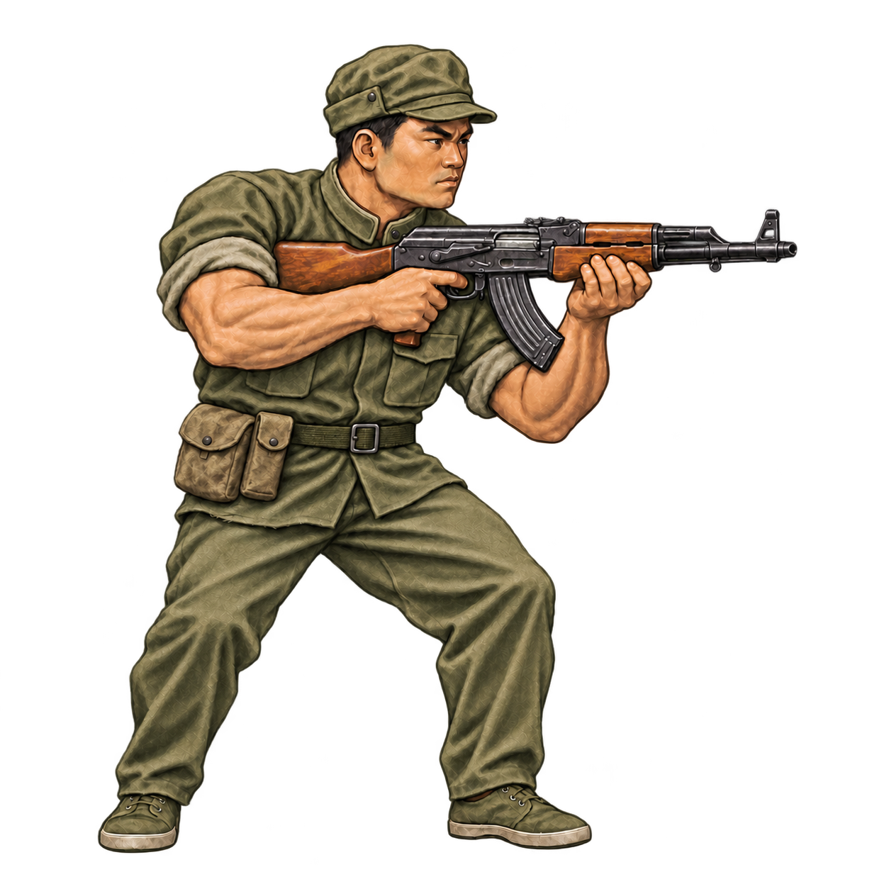

# Communist China

Approved concept: [concept-v15.png](concept-v15.png).

## Preserve

Keep the soft field cap with raised flaps and uncovered ears, the distinct Chinese face, the longer stand-collar field shirt, straight trousers, low canvas shoes, and wood-stocked AK-47. The worn olive cloth and two mismatched canvas pouches grouped at one hip give him a guerrilla silhouette. Keep the satchel off and the front of the belt clear near the buckle.

Keep the muted olive palette, muscular build, rolled cloth sleeves, bare forearms and wrists, and v10's full-body, right-facing stance. Preserve the painterly rendering and transparent framing.

## Next edit

Visual iteration is complete. Use v15 as the source for any future work.

## History

- v2: stronger faction-specific clothing silhouettes. US v2 accepted.
- v3: muscular build and faction refinements; exposed upper arms later rejected.
- v4: restored sleeves while retaining exposed forearms.
- v8–v10: rebuilt from the neutral sprite and settled on the v8 stance with a wood-stocked AK-47.
- v11–v13: explored a shorter shirt, slimmer satchel, and different pouch placements.
- v14–v15: returned to v10's shirt length, removed the satchel, and settled on two off-center belt pouches. V15 approved.

See [recorded prompts](PROMPTS.md). Do not rerun old prompts as the latest design brief.
