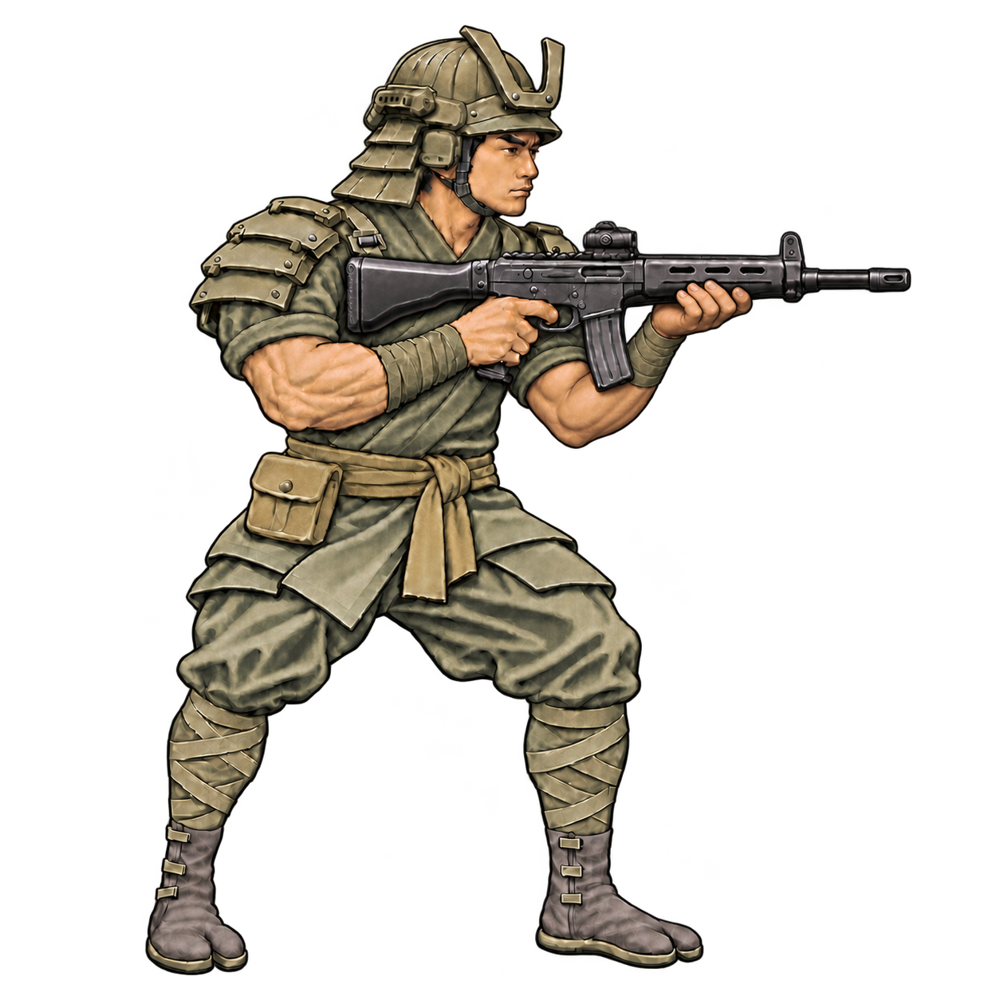

# Imperial Japan

Current source: [concept-v13.png](concept-v13.png).

## Preserve

Keep modern composite kabuto and samurai shoulder plates, split-toe boots and lower-leg/wrist wraps. Make the samurai silhouette unmistakable without antique lacquer, gold or brocade.

Shared constraints: muted olive palette, dark equipment, muscular build with upper-arm cloth sleeves and exposed muscular forearms; full figure, right-facing three-quarter rifle-ready pose and painterly game illustration. Distinguish attire, boots, trousers, headgear and weapon rather than adding pouches.

## Next edit

No new visual change specified yet. Start from this current PNG, name the precise requested change and explicitly preserve all other approved traits. Save the next revision alongside it and append the prompt and feedback here.

## History

- v2: stronger faction-specific clothing silhouettes. US v2 accepted.
- v3: muscular build and faction refinements; exposed upper arms later rejected.
- v4: restored sleeves while retaining exposed forearms.
- v13: selected for check-in after refining the forward support hand.

See [recorded prompts](PROMPTS.md). Do not rerun old prompts as the latest design brief.
