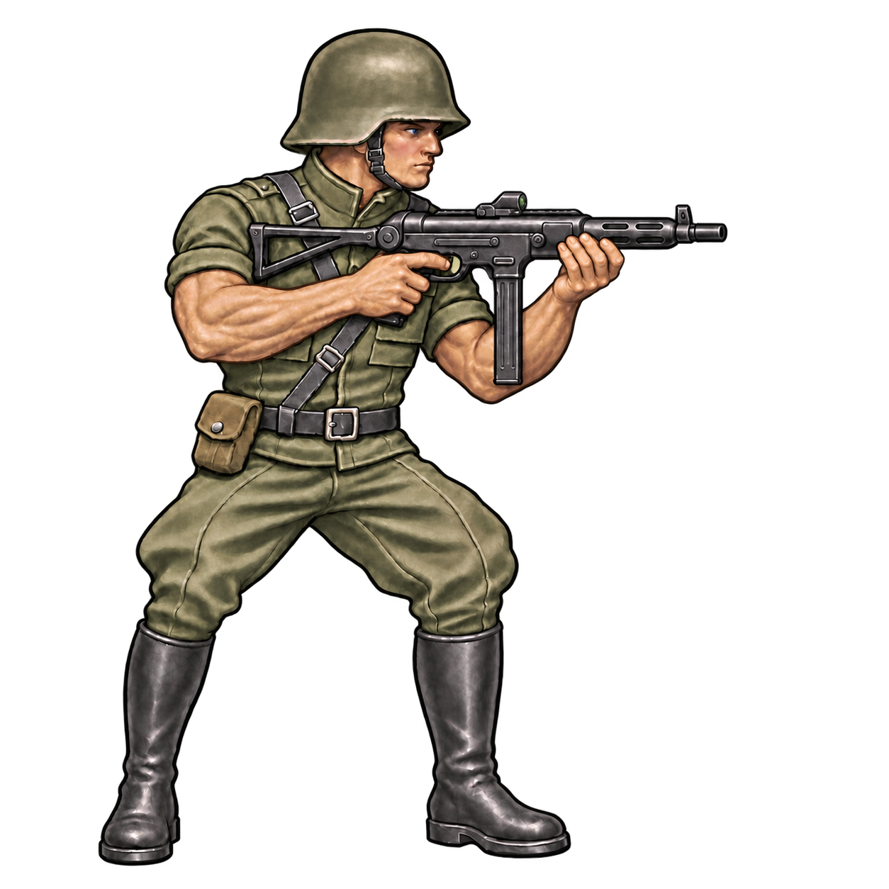

# Nazi Germany

Approved concept: [concept-v9.png](concept-v9.png).

## Preserve

Keep the plain deep-rim helmet, smooth tall black jackboots, longer MP 40-inspired submachine-gun silhouette and two-handed v5 pose. Preserve the cornflower-blue eyes and subtle rosy cheeks. Compact combat shirt and streamlined riding breeches, not the rejected stiff officer coat. No Nazi emblems, flags or slogans.

Shared constraints: muted olive palette, dark equipment, muscular build with upper-arm cloth sleeves and exposed muscular forearms; full figure, right-facing three-quarter ready pose and painterly game illustration. Distinguish attire, boots, trousers, headgear and weapon rather than adding pouches.

## Next edit

No new visual change specified yet. Start from this current PNG, name the precise requested change and explicitly preserve all other approved traits. Save the next revision alongside it and append the prompt and feedback here.

## History

- v2: stronger faction-specific clothing silhouettes. US v2 accepted.
- v3: muscular build and faction refinements; exposed upper arms later rejected.
- v4: restored sleeves while retaining exposed forearms.
- v5: removed the helmet mount, added a modern MP 40-inspired weapon silhouette and tinted the eyes blue.
- v6: shorter weapon and brighter eyes were rejected.
- v7: returned to the v5 pose and weapon length with a slight blue tint.
- v8: stronger cornflower blue and subtly rosy cheeks. Approved on 2026-11-11.
- v9: removed the gloves and wrist cuffs. Selected on 2026-11-11.

See [recorded prompts](PROMPTS.md). Do not rerun old prompts as the latest design brief.
