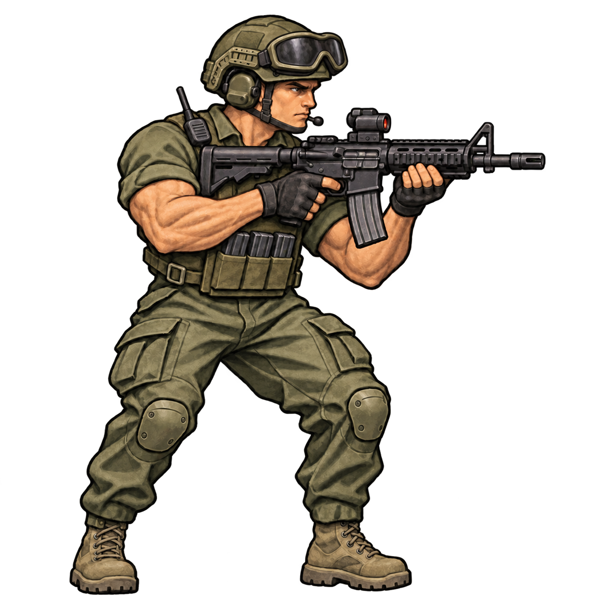

# United States

Current source: [concept-v3.png](concept-v3.png).

## Preserve

Keep the larger goggles perched above the brow as a distinct U.S. silhouette cue.

Shared constraints: muted olive palette, dark equipment, muscular build with upper-arm cloth sleeves and exposed muscular forearms; full figure, right-facing three-quarter rifle-ready pose and painterly game illustration. Distinguish attire, boots, trousers, headgear and weapon rather than adding pouches.

## Next edit

No new visual change specified yet. Start from this current PNG, name the precise requested change and explicitly preserve all other approved traits. Save the next revision alongside it and append the prompt and feedback here.

## History

- v2: stronger faction-specific clothing silhouette.
- v3: slightly larger goggles. Approved on 2026-11-11.

See [recorded prompts](PROMPTS.md). Do not rerun old prompts as the latest design brief.
